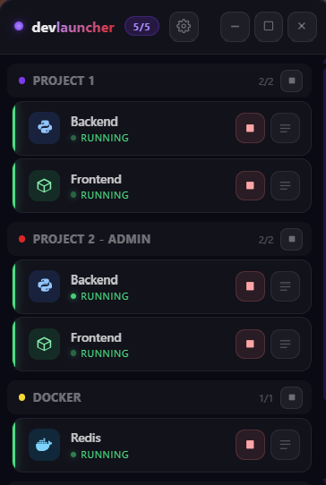

# Dev Launcher

[](https://github.com/benjaminpavone/dev-launcher/actions/workflows/ci.yml)

A small, transparent, always-on-top Windows widget to start, stop and monitor your local dev servers — uvicorn, npm/Vite, Docker containers — without keeping a terminal open for each of them.

Built with **Tauri 2** (Rust) and **Vue 3**. **Windows only** for now; a macOS version is planned.

<p align="center"></p>

## Download

From the [Releases](../../releases) page, built by GitHub Actions from the tagged source:

- **`dev-launcher_<version>_portable.exe`**: download and run, nothing to install (needs WebView2, built into Windows 10 and 11);
- **`dev-launcher_<version>_x64-setup.exe`**: installer with a Start menu shortcut and an uninstaller.

The app is not code-signed, so Windows SmartScreen may warn on first launch: click **More info**, then **Run anyway**.

## Features

- **Projects and services**: group your services by project, start or stop them one by one or all at once.
- **Live logs** for each service, with search and highlight, and a large view in a modal.
- **Clean stop**: the whole process tree is killed (npm can spawn detached `node` children that `taskkill /T` misses), so ports are free as soon as the service shows as stopped.
- **Conda support**: a service can run inside a conda environment (`conda run -n <env> …`).
- **Docker**: a `docker start <container>` command is detected; its status comes from `docker ps`, even when the container was started outside the app. Containers are left running when the app closes.
- **Shell services (fire & forget)**: launch external apps (VS Code, Teams, a `.bat`…) without tracking or killing them.
- **Settings panel** to edit projects and services, the widget opacity, and whether it stays always on top (on by default).

## Service types

| Type | How it is detected | Start | Status | Stop |
|---|---|---|---|---|
| Normal | default | `cmd /C <cmd>`, stdout and stderr captured | process alive or not | kills the process tree |
| Docker | command is `docker start <name>` | `docker start` | `docker ps` | `docker stop` |
| Shell | type "Shell" in the settings | `cmd /C start "" <cmd>` | "Launched" until you mark it stopped | nothing is killed |

## Configuration

The configuration lives in `%APPDATA%\com.devlauncher.app\config.json`. On first launch, the app creates it from the example [`config.json`](config.json) embedded in the binary; after that, edit it from the settings panel.

```json
{
	"id": "my-app-backend",
	"name": "Backend",
	"icon": "python",
	"cmd": "uvicorn main:app --port 8000 --reload",
	"cwd": "C:/path/to/my-app/backend",
	"conda_env": "my-env",
	"service_type": null
}
```

- `icon`: `python`, `node`, `docker` or `shell`.
- `conda_env`: optional, `null` to run the command as is.
- `service_type`: `null` (or omitted) for a normal or Docker service, `"shell"` for fire & forget.

## Development

Prerequisites: [Rust](https://rustup.rs/), [Node.js](https://nodejs.org/) and the [Tauri prerequisites for Windows](https://tauri.app/start/prerequisites/).

```bash
npm install
npm run tauri dev
```

## Release build

```bash
npm run build:release
```

Do not run `npm run tauri build` directly: it does not bump the version. `build:release`:

1. bumps the **patch** version in `package.json`, `src-tauri/tauri.conf.json`, `src-tauri/Cargo.toml` and `src-tauri/Cargo.lock` (`scripts/bump-version.js`, which can also be run alone);
2. runs `npm run tauri build`;
3. renames the executable to `src-tauri\target\release\dev-launcher_<version>.exe` (`scripts/rename-exe.js`).

After each release, add a section at the top of [`CHANGELOG.md`](CHANGELOG.md).

To publish installers on GitHub, push a tag matching the version: `git tag v1.0.0 && git push origin v1.0.0`. The [release workflow](.github/workflows/release.yml) builds on a Windows runner and attaches the installers to a draft release, which you then publish.

## Troubleshooting: servers left running

If servers survive a crash, kill them by command line instead of killing every `node.exe` or `python.exe` (which would also kill unrelated tools):

```powershell
# Vite / npm run dev
Get-CimInstance Win32_Process | Where-Object { $_.CommandLine -match 'vite' } | ForEach-Object { Stop-Process -Id $_.ProcessId -Force }

# uvicorn
Get-CimInstance Win32_Process | Where-Object { $_.CommandLine -match 'uvicorn' } | ForEach-Object { Stop-Process -Id $_.ProcessId -Force }
```

## License

[MIT](LICENSE)
